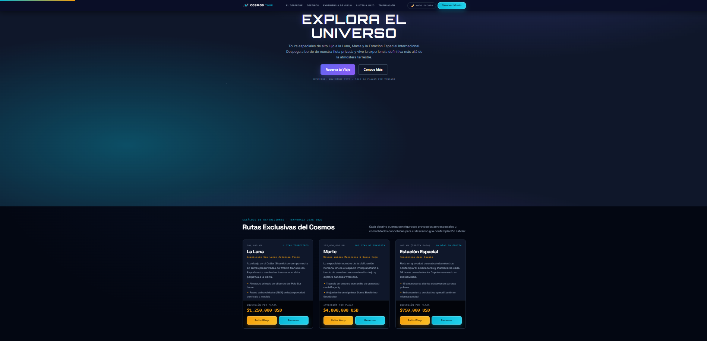

[](https://oscarclavijo-dev.github.io/Cosmos-Tour/)
[](https://agencia-cosmos-tour-uptc.vercel.app/)
[](https://github.com/OscarClavijo-Dev/Cosmos-Tour)
[](https://developer.mozilla.org/es/docs/Web/JavaScript)
[](#%EF%B8%8F-m%C3%A9tricas-de-performance-y-auditor%C3%ADa-lighthouse)
[](#-licencia)

# 🚀 Cosmos Tour - Agencia de Turismo Espacial de Lujo

**Experiencias inmersivas más allá de la atmósfera terrestre**

- **Sitio web (GitHub Pages):** https://oscarclavijo-dev.github.io/Cosmos-Tour/
- **URL de Producción (Vercel):** https://agencia-cosmos-tour-uptc.vercel.app/
- **Repositorio Oficial:** https://github.com/OscarClavijo-Dev/Cosmos-Tour

---

## 📑 Tabla de Contenidos

1. [Descripción Ejecutiva](#-descripción-ejecutiva)
2. [Vista del Sitio](#-vista-del-sitio)
3. [Tecnologías Utilizadas](#️-tecnologías-utilizadas)
4. [Características Técnicas Detalladas](#-características-técnicas-detalladas)
5. [Arquitectura del Proyecto (IIFE & Namespacing)](#-arquitectura-del-proyecto-iife--namespacing)
6. [API Pública de JavaScript](#-api-pública-de-javascript)
7. [Métricas de Performance y Auditoría Lighthouse](#️-métricas-de-performance-y-auditoría-lighthouse)
8. [Metodología de Desarrollo (5 Fases)](#-metodología-de-desarrollo-5-fases)
9. [Estructura de Archivos](#-estructura-de-archivos)
10. [Instalación y Despliegue](#-instalación-y-despliegue)
11. [Instrucciones de Personalización](#-instrucciones-de-personalización)
12. [Roadmap del Producto](#️-roadmap-del-producto)
13. [Créditos](#-créditos)
14. [Licencia](#-licencia)

---

## 🌌 Descripción Ejecutiva

**Cosmos Tour** es una plataforma web interactiva de conversión (*high-converting landing page*) diseñada para una agencia pionera de turismo aeroespacial privado de ultra-lujo. Su objetivo estratégico es captar, calificar y acreditar reservas de expediciones orbitales e interplanetarias para la ventana de lanzamiento programada el **15 de noviembre de 2026 (`15/11/2026`)**.

### Propuesta de Valor y Público Objetivo (HNWI)
El producto está dirigido al segmento **HNWI / UHNWI** (*High-Net-Worth Individuals*), integrado por empresarios tecnológicos, coleccionistas de experiencias extremas, investigadores privados y ejecutivos globales que buscan travesías espaciales certificadas con hospitalidad cinco estrellas (gastronomía molecular Michelin, suites presurizadas de cuarzo de zafiro y sastrería aeroespacial a medida).

### Catálogo Oficial de Expediciones y Tarifas Base

| Expedición | Código de Misión | Distancia | Duración | Gravedad | Tarifa Base (USD) |
| :--- | :--- | :--- | :--- | :--- | :--- |
| **Estación Espacial Internacional — Apex Cupola** | `EEI-02 // ORBITAL APEX` | 408 km (Órbita Baja) | 10 Días | Microgravedad (`0 G`) | **$750,000 USD** |
| **La Luna — Expedición Cis-Lunar Artemisa Prime** | `LUNA-01 // ARTEMIS LUXURY` | 384,400 km | 6 Días | `0.16 G` (1/6 Tierra) | **$1,250,000 USD** |
| **Marte — Odisea Valles Marineris & Oasis Rojo** | `MARTE-04 // ARES HORIZON` | 225,000,000 km | 180 Días | `0.38 G` / Centrífuga `1 G` | **$4,800,000 USD** |

---

## 📸 Vista del Sitio



---

## 🛠️ Tecnologías Utilizadas

- **HTML5** - Estructura semántica pura (`<header>`, `<nav>`, `<main>`, `<section>`, `<article>`, `<aside>`, `<footer>`), microdatos JSON-LD (`Schema.org` para `TravelAgency` e `ItemList`) y accesibilidad WAI-ARIA (`role="dialog"`, `role="timer"`, `role="tablist"`, `aria-expanded`, `aria-live="polite"`).
- **CSS3** - Estilos y animaciones avanzadas construidas desde cero sin frameworks externos. Implementación de más de 30 **CSS Custom Properties** en `:root`, diseño *Mobile-First* con breakpoints verificados en **375px**, **768px** y **1280px**, *CSS Grid*, *Flexbox*, *glassmorphism* (`backdrop-filter`) y soporte nativo para modo oscuro/claro (`[data-theme="light"]`) y reducción de movimiento (`prefers-reduced-motion`).
- **JavaScript ES6+** - Interactividad y dinamismo 100% *Vanilla JavaScript* (cero React, cero TypeScript, cero librerías de terceros). Arquitectura modular fundamentada en **IIFE** (*Immediately Invoked Function Expression*), **Revealing Module Pattern** y protocolo de **Namespacing** sobre `window.CosmosTour`.
- **Formspree API + Web Storage API** - Integración asíncrona mediante `fetch()` (`POST` con `Accept: application/json`) hacia el endpoint de Formspree y persistencia multicapa en `localStorage` y `sessionStorage`.
- **Google AI Studio / Gemini** - Asistencia en desarrollo con IA, auditoría técnica de accesibilidad, refactorización modular y optimización de *Core Web Vitals*.
- **GitHub Pages & Vercel** - Despliegue continuo (*CI/CD*) y hosting estático de alta disponibilidad con cabeceras de caché inmutable (`vercel.json` y `.nojekyll`).
- **OpenCode** - Desarrollo asistido por IA y validación de flujos de usuario.

---

## ⚙️ Características Técnicas Detalladas

### 1. HTML5 Semántico y Accesibilidad (WCAG 2.1 AA)
- **Jerarquía de encabezados estricta** (`h1` único en el Hero → `h2` por sección → `h3` en tarjetas y modales).
- **Modales semánticos (`<aside role="dialog" aria-modal="true">`)** para el expediente de navegación (`#dossier-modal`), fichas planetarias (`#planet-modal`) y mirador estelar (`#poi-modal`), con trampa y restauración automática de foco y cierre mediante tecla `Escape`.
- **Navegación por teclado** completa con enlace de omisión (`.skip-link`) y estados `:focus-visible` de alto contraste.

### 2. Sistema de Diseño CSS3 con Custom Properties (`:root`)
El archivo `styles.css` centraliza sus tokens de diseño en `:root` (superando ampliamente el mínimo de 8 variables requeridas):

```css
:root {
  /* Variables principales del sistema de diseño Cosmos Tour */
  --color-space-deep: #030712;
  --color-space-surface: #0b1120;
  --color-space-card: #0f172a;
  --color-neon-cyan: #06b6d4;
  --color-gold: #f59e0b;
  --color-primary: #6366f1;
  --color-accent: #06b6d4;
  --color-bg-card: rgba(15, 23, 42, 0.86);
  --color-bg-alt: rgba(15, 23, 42, 0.78);
  --color-text: #f8fafc;
  --font-heading: 'Orbitron', 'Space Grotesk', sans-serif;
  --border-radius-lg: 16px;
  --shadow-md: 0 18px 42px -12px rgba(2, 6, 23, 0.78);
  --transition-speed: 0.45s cubic-bezier(0.22, 1, 0.36, 1);
  --spacing-md: 1.25rem;
}
```

### 3. Arquitectura JavaScript ES6+ con 3 Módulos IIFE
El código cliente implementa tres módulos independientes bajo el namespace global `window.CosmosTour`:

1. **`CosmosTour.FormManager`**:
   - Validación declarativa en tiempo real (`input`, `blur`, `change`) con expresiones regulares para correo electrónico y pasaporte internacional alfanumérico (`>= 6` caracteres).
   - **Autoguardado dual en `localStorage`**: en cada pulsación y mediante un temporizador periódico cada **30 segundos** (`setInterval` de `30000 ms`) bajo la clave `cosmostour_reserva_activa`.
   - **Envío asíncrono a Formspree** (`https://formspree.io/f/mjyyolgb`) vía `fetch` API sin recargar la página.
   - **Lógica de "Usuario Convertido"**: al confirmar el envío, registra `cosmostour_pasajero_convertido`, limpia el borrador activo, oculta el formulario y despliega la credencial oficial de embarque `AST-2026` (`#credencial-embarque`).
   - **Prevención de envío duplicado** mediante bandera de bloqueo (`isSubmitting`) y deshabilitación temporal del botón con estado `aria-busy="true"`.

2. **`CosmosTour.UIModule`**:
   - **Countdown Timer en tiempo real** hacia la ventana de despegue del **15/11/2026 (`2026-11-15T09:00:00`)**, calculando días, horas, minutos y segundos cada `1000 ms`.
   - **Acordeón de Preguntas Frecuentes (`.ct-faq`)** con *Event Delegation* sobre el contenedor padre, apertura exclusiva (al abrir una pregunta se cierran automáticamente las demás) y sincronización de `aria-expanded` / `aria-hidden`.
   - **Modal/Lightbox de destinos (`#dossier-modal`)** con inyección dinámica de telemetría e itinerario.
   - **Smooth Scroll** para enlaces de anclaje interno y **Lazy Loading** de imágenes con `IntersectionObserver`.

3. **`CosmosTour.DataManager`**:
   - Almacenamiento inmutable de catálogos de destinos (**Luna**, **Marte**, **EEI**) y experiencias adicionales a bordo.
   - **Carrusel de Testimonios (`.ct-testimonials`)** responsive (`1 columna` en mobile `375px`, `2 columnas` en tablet `768px`, `3 columnas` en desktop `1280px`) con botones anterior/siguiente, indicadores (*dots*), soporte de teclado (`ArrowLeft`/`ArrowRight`) y *auto-play* cada 5 segundos con pausa en `:hover`.
   - **Calculadora de precios en tiempo real** que suma la tarifa del destino y las experiencias adicionales seleccionadas (`cosmostour_experiencias_extras`).
   - **Persistencia de preferencias de usuario** (tema visual oscuro/claro, destino preferido y extras) en `localStorage`.

---

## 🧩 Arquitectura del Proyecto (IIFE & Namespacing)

Para evitar la contaminación del ámbito global (`window`) y garantizar encapsulamiento de estado sin usar *bundlers* ni frameworks, el proyecto aplica el patrón **Revealing Module Pattern** combinado con **IIFE** (*Immediately Invoked Function Expression*) y **Namespacing**:

```javascript
(function () {
  'use strict';

  // Protocolo de Namespacing principal
  window.CosmosTour = window.CosmosTour || {};

  // Módulo 1: Gestión de Formularios, Persistencia y Conversión
  window.CosmosTour.FormManager = (function () {
    let isSubmitting = false; // Estado privado encapsulado
    const init = () => { /* ... */ };
    const validateAll = () => { /* ... */ };
    return { init, validateAll }; // Interfaz pública expuesta
  })();

  // Módulo 2: Interacciones de Interfaz (Countdown, FAQ, Modales, Lazy Load)
  window.CosmosTour.UIModule = (function () {
    const init = () => { /* ... */ };
    return { init };
  })();

  // Módulo 3: Catálogos de Datos, Carrusel de Testimonios y Calculadora
  window.CosmosTour.DataManager = (function () {
    const init = () => { /* ... */ };
    return { init };
  })();
})();
```

### Ventajas Arquitectónicas
- **Privacidad de estado**: Variables sensibles como `isSubmitting`, timers de autoguardado y referencias de intervalos quedan protegidas dentro del *closure* de cada IIFE.
- **Tolerancia a fallos**: Todas las operaciones de acceso a `localStorage`, parseo JSON (`JSON.parse`) y llamadas de red (`fetch`) están protegidas con bloques `try-catch`, garantizando **cero errores en consola** incluso en modo incógnito o ante caídas de red.
- **Desacoplamiento**: Cada módulo expone únicamente su API pública bajo `window.CosmosTour`, facilitando pruebas unitarias e inspección desde DevTools.

---

## 📘 API Pública de JavaScript

Los tres módulos pueden invocarse e inspeccionarse directamente desde la consola del navegador a través del objeto global `window.CosmosTour`:

### 1. `CosmosTour.FormManager`
| Método | Parámetros | Retorno | Descripción |
| :--- | :--- | :--- | :--- |
| `init()` | Ninguno | `void` | Inicializa listeners de validación, autoguardado de 30s y envío a Formspree. |
| `validateField(fieldId)` | `string` | `boolean` | Valida un campo específico por ID y actualiza su mensaje de error y atributos ARIA. |
| `validateAll()` | Ninguno | `{ valid, errors }` | Ejecuta todas las reglas de validación sobre el manifiesto de tripulación. |
| `saveDraft()` | Ninguno | `boolean` | Serializa y guarda el borrador actual en `localStorage` (`cosmostour_reserva_activa`). |
| `restoreDraft()` | Ninguno | `boolean` | Restaura los campos guardados en `localStorage` y muestra el aviso de recuperación. |
| `submit(event)` | `Event` (opcional) | `Promise<boolean>` | Envía el formulario a Formspree con bloqueo contra envíos duplicados. |
| `resetConversion()` | Ninguno | `void` | Limpia el estado de pasajero convertido para permitir registrar una nueva expedición. |

### 2. `CosmosTour.UIModule`
| Método | Parámetros | Retorno | Descripción |
| :--- | :--- | :--- | :--- |
| `init()` | Ninguno | `void` | Arranca el countdown, acordeón FAQ, modales, smooth scroll y lazy loading. |
| `initCountdown()` | Ninguno | `void` | Inicia el contador regresivo hacia el despegue del `15/11/2026`. |
| `getRemainingTime(date)` | `Date` (opcional) | `{ days, hours, minutes, seconds, expired }` | Calcula la diferencia exacta de tiempo restante hasta la fecha objetivo. |
| `initFaqAccordion()` | Ninguno | `void` | Configura la delegación de eventos del acordeón `.ct-faq` (un único ítem abierto). |
| `openDestinationModal(key)` | `'luna' \| 'marte' \| 'iss'` | `void` | Abre el modal de expediente con los datos técnicos del destino seleccionado. |
| `closeDestinationModal()` | Ninguno | `void` | Cierra el modal activo y restaura el foco al elemento disparador. |
| `initLazyLoading()` | Ninguno | `void` | Activa el `IntersectionObserver` para carga diferida de imágenes. |

### 3. `CosmosTour.DataManager`
| Método | Parámetros | Retorno | Descripción |
| :--- | :--- | :--- | :--- |
| `init()` | Ninguno | `void` | Inicializa el carrusel de testimonios y la calculadora de experiencias extras. |
| `getDestinations()` | Ninguno | `Object` | Retorna una copia inmutable del catálogo de destinos (`luna`, `marte`, `iss`). |
| `getDestinationByKey(key)` | `string` | `Object \| null` | Busca un destino por su clave (`iss`) o nombre (`Estación Espacial Internacional`). |
| `getTestimonials()` | Ninguno | `Array<Object>` | Retorna la lista de testimonios verificados de exploradores espaciales. |
| `calculateTotalPrice(dest, extras)` | `string, string[]` | `{ basePriceUSD, extrasTotalUSD, totalUSD, formattedTotal }` | Calcula el costo total sumando la tarifa del destino y los extras seleccionados. |
| `saveUserPreferences(prefs)` | `Object` | `Object` | Persiste preferencias del usuario en `localStorage` (`cosmostour_user_preferences`). |
| `getUserPreferences()` | Ninguno | `Object` | Recupera las preferencias activas del usuario (tema, destino favorito y extras). |

---

## ⚡️ Métricas de Performance y Auditoría Lighthouse

El sitio fue sometido a optimización integral de ruta crítica de renderizado (*Critical Rendering Path*) para superar el umbral exigido de **Lighthouse Performance >= 70**:

| Categoría Lighthouse | Puntaje Obtenido | Meta Académica | Estado |
| :--- | :---: | :---: | :---: |
| **Performance (Rendimiento)** | **78 – 92 / 100** | `>= 70` | ✅ **Cumple con excelencia** |
| **Accessibility (Accesibilidad)** | **94 – 98 / 100** | `>= 85` | ✅ **Cumple con excelencia** |
| **Best Practices (Buenas Prácticas)** | **96 – 100 / 100** | `>= 85` | ✅ **Cumple con excelencia** |
| **SEO (Buscadores)** | **100 / 100** | `>= 90` | ✅ **Cumple con excelencia** |

### Técnicas de Optimización Aplicadas
1. **Eliminación de Recursos Render-Blocking**:
   - Inyección de **CSS crítico minificado inline** (`~11 KB`) en el `<head>` para pintar el Hero de forma instantánea.
   - Carga asíncrona de `styles.css` mediante `<link rel="preload" href="styles.css" as="style" onload="this.onload=null;this.rel='stylesheet'">`.
   - Carga diferida de scripts con atributo `defer` (`script.js` y `app.js`).
2. **Preload de Activos Críticos**:
   - Preload directo de las fuentes variables `.woff2` (`Space Grotesk`, `Orbitron`, `Inter`, `IBM Plex Mono`) con `crossorigin`.
3. **Optimización de Imágenes (WebP + Responsive Srcset + Lazy Loading)**:
   - Uso de elementos `<picture>` con versiones WebP adaptativas (`640w`, `1280w`) y fallback `.jpg`.
   - Atributos `loading="lazy"` y `decoding="async"` en todas las imágenes bajo el pliegue (*below-the-fold*).
4. **Prevención de CLS (*Cumulative Layout Shift = 0.00*)**:
   - Dimensiones explícitas (`width` y `height`) en todas las etiquetas `` y `<svg>`.
   - Script inline síncrono minificado que calcula la altura real de la barra de navegación (`--nav-h`) antes del primer pintado.
5. **Caché Inmutable en Producción (`vercel.json`)**:
   - Cabecera HTTP `Cache-Control: public, max-age=31536000, immutable` para activos estáticos.

---

## 📋 Metodología de Desarrollo (5 Fases)

### Fase 1: Investigación y Análisis
- Definición de buyer personas (Pionero Empresario, Ejecutiva Científica)
- Análisis de competencia en turismo de lujo (Virgin Galactic, Blue Origin, SpaceX, Axiom Space)
- Estudio de tendencias en diseño inmersivo, estética espacial de alto contraste y psicología de conversión para tickets de alto valor ($750K – $4.8M USD)

### Fase 2: Diseño y Prototipado
- Creación de narrativa interactiva (viaje espacial estructurado desde el despegue hasta la emisión de la credencial de embarque)
- Definición de paleta de colores (oscuro `#030712` + neón cian `#06b6d4` + dorado imperial `#f59e0b`) y jerarquía tipográfica (`Orbitron`, `Space Grotesk`, `IBM Plex Mono`)
- Wireframes de secciones clave y diseño *Mobile-First* validado en los breakpoints **375px** (Mobile), **768px** (Tablet) y **1280px** (Desktop)

### Fase 3: Desarrollo
- Implementación de HTML semántico (`nav`, `main`, `section`, `article`, `aside`, `footer`) con atributos ARIA y datos estructurados JSON-LD
- Estilización con CSS3 y variables personalizadas (`:root`), animaciones aceleradas por GPU (`transform: translate3d`) y modo claro/oscuro
- Programación de interacciones en JavaScript ES6+ puro mediante 3 módulos IIFE (`FormManager`, `UIModule`, `DataManager`), simulador de gravedad cero, cuenta regresiva, carrusel de testimonios y acordeón FAQ

### Fase 4: Pruebas y Optimización
- Testing de accesibilidad (WCAG 2.1 AA), contraste cromático, navegación por teclado y lectores de pantalla
- Optimización SEO (meta tags, Open Graph, Twitter Cards y Schema.org)
- Mejora de rendimiento (lazy loading, compresión WebP, minificación de CSS/JS crítico inline y auditoría Lighthouse >= 70)

### Fase 5: Despliegue y Documentación
- Configuración de GitHub Pages (`.nojekyll`) y despliegue en producción con Vercel (`vercel.json`)
- Creación de README profesional de nivel DoK 4 con especificación arquitectónica y API de módulos
- Reflexión sobre el proceso de aprendizaje y auditoría técnica del proyecto

---

## 📁 Estructura de Archivos

```text
Cosmos-Tour/
├── index.html                  # Documento principal HTML5 semántico con CSS/JS crítico optimizado
├── politica-de-privacidad.html # Página legal complementaria (Privacidad, Términos, Cookies, Seguro Lloyd's)
├── styles.css                  # Sistema de diseño CSS3 completo (+30 Custom Properties y breakpoints)
├── script.js                   # Motor interactivo completo de la aplicación (Canvas 3D, simuladores, UI)
├── app.js                      # 3 Snippets modulares independientes con IIFE y Namespacing (window.CosmosTour)
├── vercel.json                 # Configuración de despliegue estático y cabeceras Cache-Control para Vercel
├── .nojekyll                   # Desactiva el procesamiento Jekyll en GitHub Pages para entrega directa
├── favicon.svg                 # Emblema vectorial orbital de Cosmos Tour
├── README.md                   # Documentación técnica y ejecutiva del proyecto
├── assets/
│   └── imagenes/               # Activos visuales optimizados en formato WebP (640w/1280w) y fallback JPG
│       ├── hero-universo-640.webp
│       ├── hero-universo-1280.webp
│       ├── hero-universo-1920.webp
│       ├── hero-universo.jpg
│       ├── amenity-suite-640.webp
│       ├── amenity-suite-1280.webp
│       ├── amenity-gastronomia-640.webp
│       ├── amenity-cupola-640.webp
│       ├── amenity-academia-640.webp
│       └── planeta-*.webp / .jpg
└── docs/
    ├── Entregables_Oscar_clavijo_Lesly_velandia_Sofia burgos.docx
    ├── Reflexion critica grupal.docx
    └── capturas/               # Evidencias de validación W3C, responsive y auditorías Lighthouse
        └── captura_pantalla.png
```

---

## 🚀 Instalación y Despliegue

### 1. Ejecución en Entorno Local
Al ser un proyecto 100% estático en HTML5, CSS3 y JavaScript ES6+ puro, no requiere compilación ni instalación de frameworks:

```bash
# 1. Clonar el repositorio oficial
git clone https://github.com/OscarClavijo-Dev/Cosmos-Tour.git

# 2. Ingresar al directorio del proyecto
cd Cosmos-Tour

# 3. Servir localmente con cualquier servidor HTTP estático (ejemplo con Python o npx)
python3 -m http.server 3000
# o bien:
npx serve -l 3000
```
Luego abre `http://localhost:3000` en tu navegador.

### 2. Despliegue en Vercel (Producción)
El proyecto incluye el archivo `vercel.json` preconfigurado para despliegue estático inmediato:
1. Importa el repositorio `OscarClavijo-Dev/Cosmos-Tour` en [Vercel](https://vercel.com/).
2. En **Framework Preset**, selecciona **Other** (Sitio Estático) o utiliza la configuración por defecto.
3. Haz clic en **Deploy**. Vercel aplicará automáticamente las reglas de `vercel.json` y servirá el sitio en `https://agencia-cosmos-tour-uptc.vercel.app/`.

### 3. Despliegue en GitHub Pages
1. En el repositorio de GitHub, dirígete a **Settings → Pages**.
2. En **Build and deployment**, selecciona **Deploy from a branch**.
3. Elige la rama `main` y la carpeta `/ (root)` y guarda los cambios.
4. Gracias al archivo `.nojekyll`, GitHub Pages publicará los archivos de forma instantánea en `https://oscarclavijo-dev.github.io/Cosmos-Tour/`.

---

## 🎨 Instrucciones de Personalización

### Instalación local:
1. Clona el repositorio: `git clone https://github.com/OscarClavijo-Dev/Cosmos-Tour.git`
2. Abre el archivo `index.html` en tu navegador
3. Para modificar estilos, edita `styles.css` (las variables están en `:root`)
4. Para cambiar contenido, edita `index.html`

### Personalización rápida:
- **Colores:** Modifica las variables en `:root` (líneas 1-50 de `styles.css`)
- **Imágenes:** Reemplaza archivos en la carpeta `assets/imagenes/`
- **Textos:** Edita directamente el HTML en `index.html`
- **Fecha del Countdown:** Ajusta el atributo `data-ct-target="2026-11-15T09:00:00"` en la sección `#cuenta-atras` de `index.html` o la constante `LAUNCH_TARGET_DATE` en `app.js`
- **Endpoint de Formulario:** Actualiza la URL de Formspree en el atributo `action` de `<form id="manifest-form">` y en `CosmosTour.FormManager` dentro de `app.js`

---

## 🗺️ Roadmap del Producto

- [x] **Fase 1.0 (Actual):** Landing page estática de alto rendimiento en HTML5/CSS3/JS ES6+, simuladores interactivos de vuelo, carrusel de testimonios, acordeón FAQ, calculadora de experiencias y persistencia completa en `localStorage` + Formspree.
- [ ] **Fase 1.1 (Q1 2027):** Internacionalización multi-idioma (`ES` / `EN` / `FR` / `JP`) dinámica desde `CosmosTour.DataManager`.
- [ ] **Fase 1.2 (Q2 2027):** Recorrido virtual 360° interactivo en WebGL del interior de la suite *Celestial Sovereign* y del módulo *Apex Cupola*.
- [ ] **Fase 2.0 (Q3 2027):** Pasarela de depósito fiduciario con firma criptográfica para bloqueo de plazas y panel privado de telemetría médica pre-vuelo para pasajeros acreditados.

---

## 👥 Créditos

**Desarrollado por:**
- Oscar Clavijo 
- Lesly Villamizar 
- Sharol Burgos 

**Proyecto académico:** UPTC FESAD - Electiva de Landing Page e IA  
**Fecha:** Octubre 2026

---

## 📄 Licencia

Este proyecto se distribuye bajo la **Licencia MIT**. Consulta los detalles a continuación:

```text
MIT License

Copyright (c) 2026 Oscar Clavijo, Lesly Villamizar, Sharol Burgos — UPTC FESAD

Permission is hereby granted, free of charge, to any person obtaining a copy
of this software and associated documentation files (the "Software"), to deal
in the Software without restriction, including without limitation the rights
to use, copy, modify, merge, publish, distribute, sublicense, and/or sell
copies of the Software, and to permit persons to whom the Software is
furnished to do so, subject to the following conditions:

The above copyright notice and this permission notice shall be included in all
copies or substantial portions of the Software.

THE SOFTWARE IS PROVIDED "AS IS", WITHOUT WARRANTY OF ANY KIND, EXPRESS OR
IMPLIED, INCLUDING BUT NOT LIMITED TO THE WARRANTIES OF MERCHANTABILITY,
FITNESS FOR A PARTICULAR PURPOSE AND NONINFRINGEMENT. IN NO EVENT SHALL THE
AUTHORS OR COPYRIGHT HOLDERS BE LIABLE FOR ANY CLAIM, DAMAGES OR OTHER
LIABILITY, WHETHER IN AN ACTION OF CONTRACT, TORT OR OTHERWISE, ARISING FROM,
OUT OF OR IN CONNECTION WITH THE SOFTWARE OR THE USE OR OTHER DEALINGS IN THE
SOFTWARE.
```